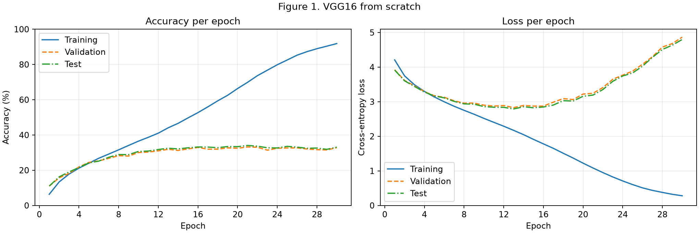
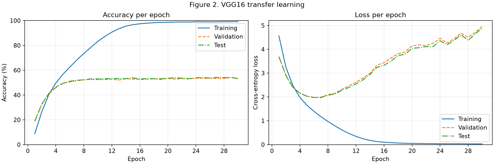
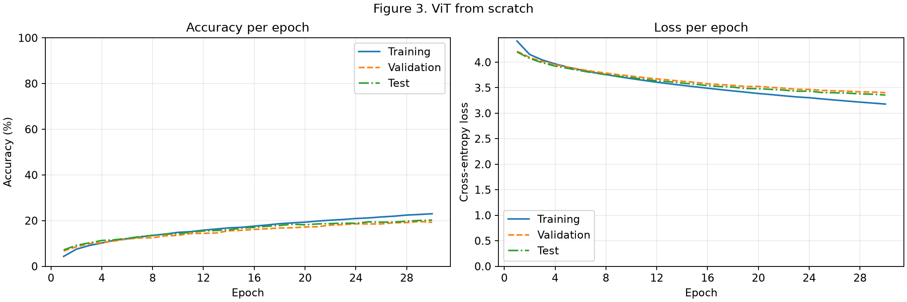
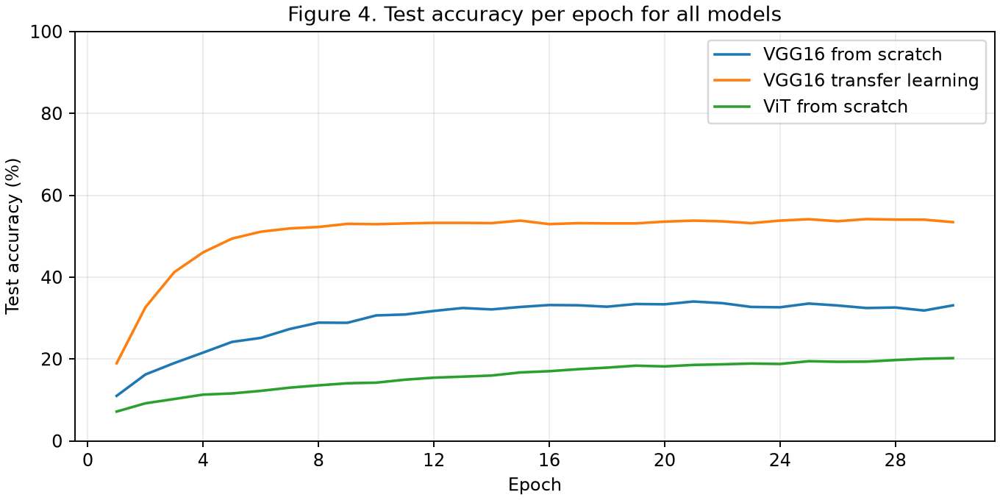
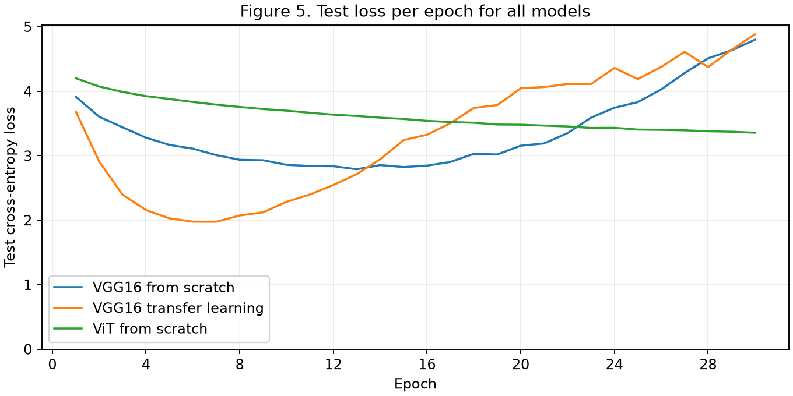
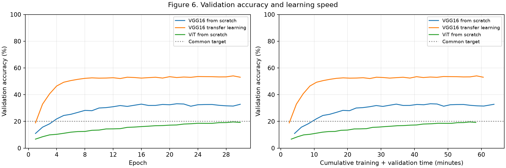
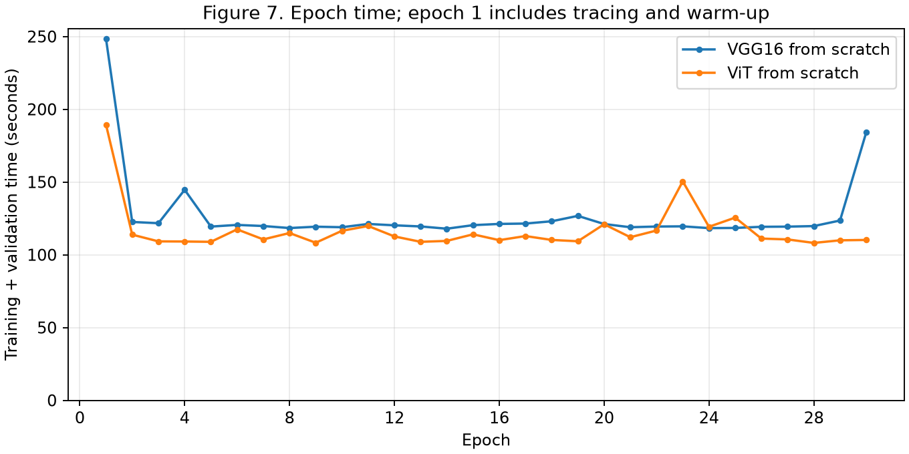

# Assignment 4 Charis Aletraris

## Experiment setup

I used the original 32 x 32 CIFAR-100 images with no resizing, a 45,000/5,000/10,000 training/validation/test split, seed 42, batch size 64, 30 epochs and AdamW learning rate 1e-05, weight decay 0.0001 and global gradient clip norm 1.0. All models used the same VGG16 channel preprocessing and device /GPU:0. I recorded test metrics after each epoch without using them for weight updates or model selection.

## Architectures

I used the VGG16 convolutional backbone with global average pooling and a 100-class softmax. Its 32 x 32 inputs produce a 1 x 1 x 512 final feature map. The scratch model used random weights; the transfer model used ImageNet weights. All layers were trainable in both models.

My ViT used 8 x 8 patches (16 tokens), 192 features, 6 pre-normalized encoder blocks, 6 attention heads with 32 features per head, GELU feed-forward layers of sizes 768 and 192, dropout 0.1, residual additions, learned positional embeddings, final LayerNorm, mean pooling and a 100-class softmax. I normalized patch projections before adding positions. I selected this compact architecture to limit attention cost and training time. It used no pretrained weights.

## Exercise 1 VGG16 from scratch

### Results for VGG16 from scratch

I obtained final validation accuracy of 32.80% and final test accuracy of 33.10%. The final test loss was 4.7990.

| Epoch | Training accuracy | Validation accuracy | Test accuracy | Training loss | Validation loss | Test loss |
|---:|---:|---:|---:|---:|---:|---:|
| 1 | 6.33% | 10.98% | 10.99% | 4.2091 | 3.9228 | 3.9144 |
| 15 | 49.68% | 32.08% | 32.71% | 1.9108 | 2.8732 | 2.8244 |
| 30 | 91.86% | 32.80% | 33.10% | 0.2802 | 4.8663 | 4.7990 |

The final training minus validation accuracy gap was +59.06 percentage points. I consider this gap together with the loss curves when assessing overfitting.

Figure 1. Left: accuracy; right: loss. Training: solid blue; validation: dashed orange; test: dash-dot green.

## Exercise 2 VGG16 transfer learning

### Results for VGG16 transfer learning

I obtained final validation accuracy of 53.06% and final test accuracy of 53.43%. The final test loss was 4.8828.

| Epoch | Training accuracy | Validation accuracy | Test accuracy | Training loss | Validation loss | Test loss |
|---:|---:|---:|---:|---:|---:|---:|
| 1 | 8.75% | 18.90% | 18.95% | 4.5592 | 3.6930 | 3.6842 |
| 15 | 96.68% | 52.84% | 53.80% | 0.1287 | 3.3367 | 3.2430 |
| 30 | 99.15% | 53.06% | 53.43% | 0.0292 | 4.9590 | 4.8828 |

The final training minus validation accuracy gap was +46.09 percentage points. I consider this gap together with the loss curves when assessing overfitting.

Figure 2. Left: accuracy; right: loss. Training: solid blue; validation: dashed orange; test: dash-dot green.

## Exercise 3 ViT from scratch

### Results for ViT from scratch

I obtained final validation accuracy of 19.24% and final test accuracy of 20.21%. The final test loss was 3.3561.

| Epoch | Training accuracy | Validation accuracy | Test accuracy | Training loss | Validation loss | Test loss |
|---:|---:|---:|---:|---:|---:|---:|
| 1 | 4.33% | 6.74% | 7.16% | 4.4147 | 4.2137 | 4.2017 |
| 15 | 17.06% | 15.76% | 16.72% | 3.5181 | 3.6061 | 3.5698 |
| 30 | 23.01% | 19.24% | 20.21% | 3.1791 | 3.4029 | 3.3561 |

The final training minus validation accuracy gap was +3.77 percentage points. I consider this gap together with the loss curves when assessing overfitting.

Figure 3. Left: accuracy; right: loss. Training: solid blue; validation: dashed orange; test: dash-dot green.

## Comparison of results

| Model | Parameters | Final validation accuracy | Final test accuracy | Final test loss | Mean epoch seconds |
|---|---:|---:|---:|---:|---:|
| VGG16 from scratch | 14,765,988 | 32.80% | 33.10% | 4.7990 | 127.58 |
| VGG16 transfer learning | 14,765,988 | 53.06% | 53.43% | 4.8828 | 121.15 |
| ViT from scratch | 2,729,380 | 19.24% | 20.21% | 3.3561 | 116.69 |

### Exercise 2 Effect of transfer learning

Transfer learning improved final test accuracy by 20.33 percentage points. Its final validation accuracy difference was +20.26 percentage points. As discussed in Lecture 5, pretrained visual features can reduce the learning required for a new task. This measured result describes their benefit or limitation under my training settings.

### Exercise 3 Comparison with VGG16 from scratch

Model with the higher final validation accuracy: VGG16 from scratch. ViT minus VGG16 final validation accuracy was -13.56 percentage points. I compare the final epoch rather than the maximum on either curve. Convolution supplies local shared filters, while attention learns relationships between patches (Lectures 3, 7 and 9). The different parameter counts also affect this comparison.

### Learning speed

I compare time and epochs to the preselected target of 20.0% validation accuracy.

- VGG16 from scratch: epoch 4, 10.62 minutes.
- VGG16 transfer learning: epoch 2, 4.68 minutes.
- ViT from scratch: not reached within the training budget.

At least one scratch model did not reach the target, so a time-to-target comparison for both is unavailable.

Mean epoch times were 127.58 seconds for VGG16 and 116.69 seconds for ViT.
Excluding epoch 1, the means were 123.41 and 114.18 seconds, respectively.

Test evaluation time is recorded separately and excluded from these epoch times. Faster epochs alone do not establish faster learning. My results use one seed and shared hyperparameters, which may not be optimal for each architecture.

Figure 4. Test accuracy per epoch for all three models.

Figure 5. Test loss per epoch for all three models.

Figure 6. Validation accuracy against epochs and cumulative training and validation time.

Figure 7. Training and validation time per epoch for VGG16 and ViT from scratch.

Sources of measurements: history.csv, summary.csv and run.json. Conceptual sources: course Lectures 3, 4, 5, 7 and 9.
